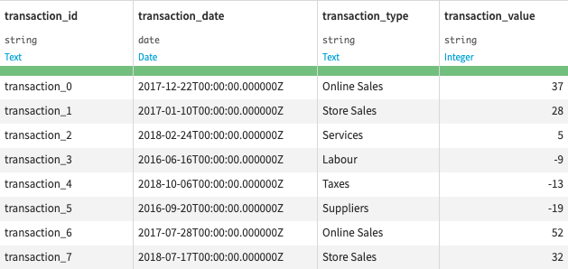
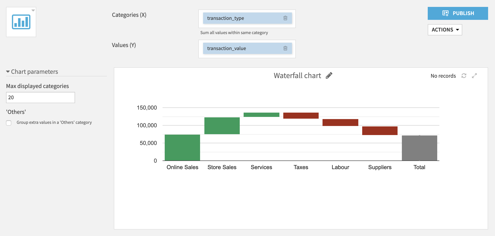

# Waterfall chart

⚠️ Starting with version 14.3.0, DSS provide a native Waterfall chart. This plugin should only be used for historical or compatibility purposes when the native chart is not an option.

This Dataiku DSS plugin adds a custom chart: the waterfall chart.

Waterfall charts are useful to visualize the cumulative value of different categories that have either positive or negative values. They are quite similar to categorical histogram using cumulative values.

This chart is based on the [Google Charts library](https://developers.google.com/chart/) and requires internet access to render on your datasets.

## Recommended alternative

Use the native DSS Waterfall chart when available:

- https://doc.dataiku.com/dss/latest/visualization/charts-other.html

The native chart is the recommended option for current DSS instances.

## How to use this plugin

The **By categories (X)** column corresponds to the different categories on which values are aggregated.

The **Show values (Y)** column corresponds to the variable that is summed for each category. 

For instance, in a dataset with transactions of different categories and values:

The Waterfall chart with **transaction_type** as the **By categories (X)** column and with **transaction_value** as the **Show values (Y)** column is:

For each type of transactions, the total sum of its values is computed and then these categories are sorted in decreasing order.

The **Total** column corresponds to the total cumulative values of all categories.

## Requirements

DSS 7.0.1 or newer is required.

## License
This project is licensed under the Apache Software License.
